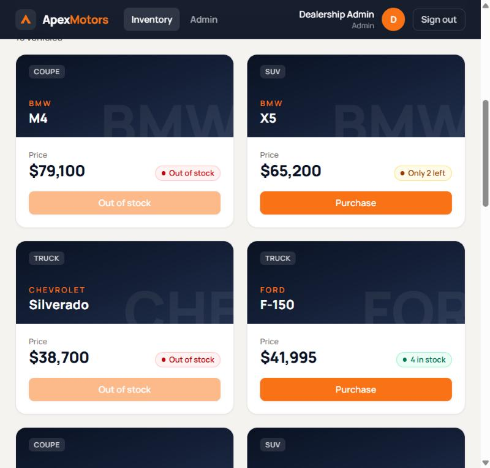
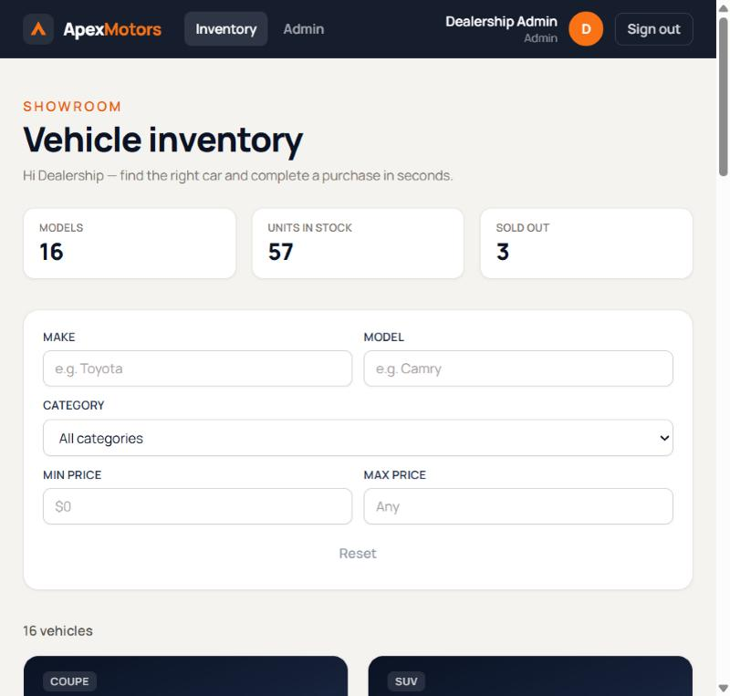
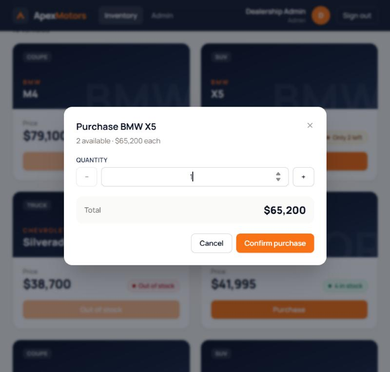
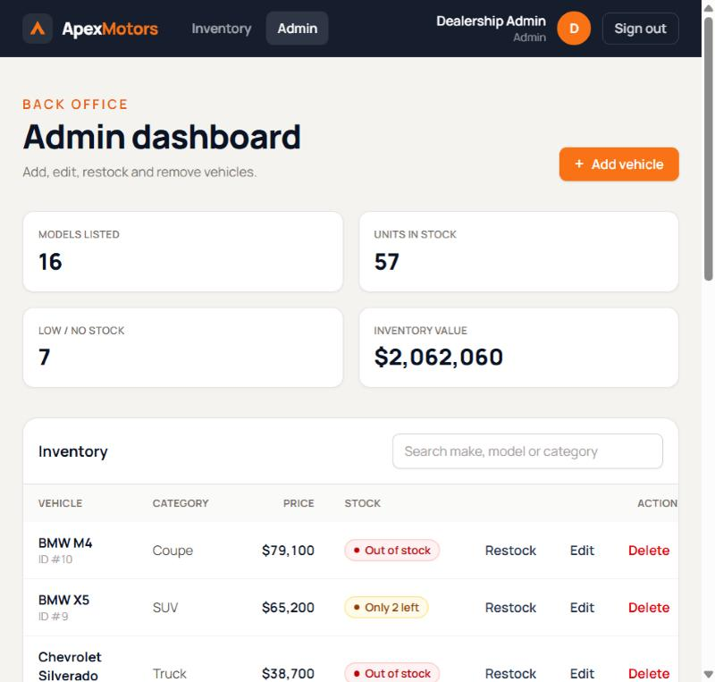
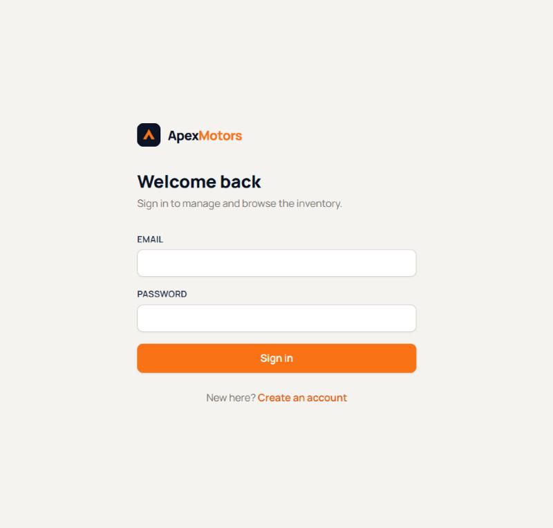

# Apex Motors: Car Dealership Inventory System

A full-stack inventory system for a car dealership. Customers can browse, search and purchase vehicles. Administrators can add, edit, delete and restock inventory. The backend enforces stock rules atomically, so concurrent purchases can never oversell a vehicle.



## Features

- **Authentication**: registration and login with bcrypt-hashed passwords and JWT bearer tokens. Sessions are restored on reload and expired tokens sign the user out automatically.
- **Role-based access control**: `customer` and `admin` roles. Every admin-only endpoint is enforced in the backend (403 for customers). The role is read from the database on each request, never trusted from the token.
- **Inventory dashboard**: vehicle cards with category, price and stock status ("Only 1 left", "Out of stock"), plus live inventory stats.
- **Search and filtering**: make and model (case-insensitive partial match), category (case-insensitive exact match) and a min/max price range. Input is debounced and served by the backend search endpoint.
- **Purchasing**: a purchase dialog with quantity selector and total price. The button is disabled when stock is zero. Each purchase is recorded in a `purchases` audit table in the same transaction as the stock decrement.
- **Admin dashboard**: add, edit, delete and restock vehicles with validated forms, confirmation dialogs and inventory value and low-stock stats.
- **Feedback**: loading spinners, empty states, inline error messages with retry, and success/error toast notifications.
- **Responsive**: layouts for phone, tablet and desktop.

## Technology stack

| Layer | Technology |
|---|---|
| Frontend | React 19, TypeScript 5.8, Vite 6, Tailwind CSS 4, React Router 7 |
| Backend | Python 3.10+, FastAPI 0.115, SQLAlchemy 2.0, Pydantic 2, PyJWT, bcrypt |
| Database | PostgreSQL (developed and tested on 16.2), Alembic migrations, psycopg 3 |
| Testing | Pytest + HTTPX (FastAPI `TestClient`), Vitest + React Testing Library + jsdom |

## Architecture

```
React SPA (Vite) ──fetch /api/*──▶ FastAPI ──SQLAlchemy──▶ PostgreSQL
  api/ service layer               routers/ (auth, vehicles)
  AuthContext (JWT)                deps.py  (current user, require_admin)
  pages/ + components/             schemas.py (Pydantic validation)
                                   models.py  (+ CHECK constraints)
```

During development Vite proxies `/api` to `http://127.0.0.1:8000`, so the browser talks to a single origin.

**Preventing overselling.** A purchase is a single conditional statement:

```sql
UPDATE vehicles SET quantity = quantity - :n
WHERE id = :id AND quantity >= :n
RETURNING *;
```

PostgreSQL row locking makes concurrent buyers wait for each other, and each one re-checks `quantity >= :n` against the committed value. If no row comes back, the API answers 404 (no such vehicle) or 409 (insufficient stock). A `CHECK (quantity >= 0)` constraint backs this up at the database level. Restock uses the same pattern, and admin edits lock the row (`SELECT … FOR UPDATE`).

### Project structure

```
backend/
  app/
    main.py            App factory, CORS, error handlers
    config.py          Settings from environment / .env
    database.py        Engine, session factory, Base
    models.py          User, Vehicle, Purchase (+ constraints)
    schemas.py         Pydantic request/response models and validation rules
    security.py        Password hashing, JWT encode/decode
    deps.py            Auth dependencies (CurrentUser, AdminUser)
    routers/           auth.py, vehicles.py
  alembic/             Migrations (0001_initial_schema)
  scripts/
    local_postgres.py  Run a project-local PostgreSQL (no admin rights needed)
    create_admin.py    Create or promote an administrator
    seed.py            Insert sample vehicles
  tests/               Pytest suite (runs against real PostgreSQL)
frontend/
  src/
    api/               Typed API client (client.ts, auth.ts, vehicles.ts)
    context/           AuthContext, ToastContext
    hooks/             useVehicles (search with stale-response protection)
    components/        VehicleCard, VehicleFilters, VehicleForm, dialogs, UI primitives
    pages/             Login, Register, Inventory, Admin
    test/              Test setup and helpers
docs/screenshots/      Screenshots of the running app
```

## Prerequisites

- Python 3.10+
- Node.js 20+ (developed with Node 24)
- PostgreSQL 14+: a system install, Docker, a hosted database, **or** the bundled helper described below

## Environment configuration

```bash
cp backend/.env.example backend/.env
cp frontend/.env.example frontend/.env   # optional; defaults work in development
```

Edit `backend/.env`:

| Variable | Purpose |
|---|---|
| `DATABASE_URL` | App database, e.g. `postgresql+psycopg://car_app:<password>@127.0.0.1:5432/car_dealership` |
| `TEST_DATABASE_URL` | Test database. **Its name must end in `_test`**, because the suite rebuilds its tables. |
| `SECRET_KEY` | JWT signing key of at least 32 characters. The app refuses to start with the placeholder. Generate one with `python -c "import secrets; print(secrets.token_urlsafe(48))"`. |
| `ACCESS_TOKEN_EXPIRE_MINUTES` | Token lifetime (default 60) |
| `CORS_ORIGINS` | Comma-separated allowed browser origins |

`.env` files are gitignored. Never commit real credentials.

## Database setup

### Option A: your own PostgreSQL

Create a role and two databases (app and test) that match your `.env`. For example, in `psql`:

```sql
CREATE ROLE car_app LOGIN PASSWORD '<password>';
CREATE DATABASE car_dealership OWNER car_app;
CREATE DATABASE car_dealership_test OWNER car_app;
```

With Docker: `docker run -d -p 5432:5432 -e POSTGRES_USER=car_app -e POSTGRES_PASSWORD=<password> -e POSTGRES_DB=car_dealership postgres:16`, then create `car_dealership_test` the same way.

### Option B: project-local PostgreSQL (no install or admin rights)

This is how the project was developed: the development machine had no PostgreSQL, Docker or admin access. `requirements-dev.txt` includes [`pgserver`](https://pypi.org/project/pgserver/), which ships real PostgreSQL 16 binaries. The helper script runs them as a normal user process:

```bash
cd backend
python scripts/local_postgres.py init    # initdb (SCRAM auth, 127.0.0.1 only) + create both databases
python scripts/local_postgres.py start   # later sessions
python scripts/local_postgres.py stop
```

It reads the role, password, port and database names from `DATABASE_URL` / `TEST_DATABASE_URL`, and stores data in `backend/.pgdata/` (gitignored). This is a full on-disk PostgreSQL server, not an in-memory substitute.

### Migrations, admin account and sample data

```bash
cd backend
alembic upgrade head
python -m scripts.create_admin --email admin@example.com --name "Site Admin"   # prompts for a password
python -m scripts.seed                                                          # 16 sample vehicles (only if the table is empty)
```

**Initial administrator.** Public registration always creates `customer` accounts; the API cannot grant itself admin rights. The admin is created out of band with `create_admin.py`. The password is prompted for without echo, or read from the `ADMIN_PASSWORD` environment variable for automation, and must meet the same password policy as registration. Running the script with an existing user's email promotes that user to admin.

## Running the backend

```bash
cd backend
python -m venv .venv
.venv/Scripts/activate            # Windows (Git Bash: source .venv/Scripts/activate); macOS/Linux: source .venv/bin/activate
pip install -r requirements-dev.txt
uvicorn app.main:app --reload --port 8000
```

Interactive API docs: http://127.0.0.1:8000/docs

## Running the frontend

```bash
cd frontend
npm install
npm run dev        # http://localhost:5173 (proxies /api to :8000)
```

## Tests

```bash
cd backend && python -m pytest          # needs TEST_DATABASE_URL and a running PostgreSQL
cd frontend && npm test                 # Vitest + React Testing Library
cd frontend && npm run typecheck && npm run build
```

Latest results (see [TEST_REPORT.md](TEST_REPORT.md)): **backend 90 passed, frontend 50 passed**, typecheck and production build clean.

## API reference

All endpoints except register and login require `Authorization: Bearer <token>`. Errors use FastAPI's `{"detail": ...}` format.

| Method | Path | Auth | Description |
|---|---|---|---|
| POST | `/api/auth/register` | public | Body `{email, full_name, password}` → 201 user. 409 if the email exists, 422 if invalid. |
| POST | `/api/auth/login` | public | Body `{email, password}` → `{access_token, token_type, user}`. 401 for bad credentials. |
| GET | `/api/auth/me` | user | Current user |
| GET | `/api/vehicles` | user | List vehicles (`limit` 1–500, default 100; `offset`) |
| GET | `/api/vehicles/search` | user | Query: `make`, `model`, `category`, `min_price`, `max_price`, `limit`, `offset`. 422 if `min_price > max_price`. |
| POST | `/api/vehicles` | admin | Body `{make, model, category, price, quantity}` → 201 |
| PUT | `/api/vehicles/{id}` | admin | Partial update with any subset of the fields above |
| DELETE | `/api/vehicles/{id}` | admin | 204. Purchase history is kept (`vehicle_id` set to null). |
| POST | `/api/vehicles/{id}/purchase` | user | Body `{quantity}` (optional, default 1) → `{purchase, vehicle}`. 409 if stock is insufficient. |
| POST | `/api/vehicles/{id}/restock` | admin | Body `{quantity}` → updated vehicle. 409 if stock would exceed 100,000. |
| GET | `/api/health` | public | Liveness check |

**Validation rules.** Price must be greater than 0 and at most 10,000,000, with up to 2 decimal places. Stock quantity must be a whole number from 0 to 100,000. Purchase and restock quantities must be 1 or more. Make and model are 1–50 characters, category 1–30 (all trimmed). Passwords need 8–72 bytes and at least one letter and one number. Status codes: 401 unauthenticated, 403 not an admin, 404 not found, 409 conflict, 422 validation error.

## Screenshots

All captured from the running application (FastAPI + PostgreSQL + Vite dev server) with seeded data.

| Inventory | Purchase dialog |
|---|---|
|  |  |
| **Admin dashboard** | **Login** |
|  |  |

Admin dashboard on a phone-width viewport: [admin-mobile.jpg](docs/screenshots/admin-mobile.jpg).

## Known limitations

- **No login rate limiting or lockout.** Brute-force protection should be added at the reverse proxy or with a rate-limiting middleware before production use.
- **Stateless JWTs**: logout is client-side only, and a token stays valid until it expires (60 minutes by default). Role changes and deleted users do take effect immediately, because the user is reloaded on every request.
- **Token in `localStorage`**: simple, but readable by any XSS on the origin. An httpOnly cookie with CSRF protection would be stronger.
- **List size**: the UI requests up to 500 vehicles and has no pagination controls (the API supports `limit` and `offset`).
- **Admin table on phones** scrolls horizontally inside its card rather than reflowing into cards.
- **Modal focus** moves into dialogs and returns afterwards, but Tab is not fully trapped inside the dialog.
- No purchase-history UI (purchases are recorded in the database only), no vehicle images, no payment processing.

## Deployment

The following is a suggested approach. **It has not been carried out or verified for this project.**

1. Provision PostgreSQL (for example a managed instance) and create the app database.
2. Backend: set `DATABASE_URL`, a strong `SECRET_KEY` and `CORS_ORIGINS` (the frontend's origin) as environment variables, then run `alembic upgrade head` and `python -m scripts.create_admin …` once. Serve with `uvicorn app.main:app --host 0.0.0.0 --port 8000 --workers 4` (or gunicorn with uvicorn workers) behind an HTTPS reverse proxy.
3. Frontend: `VITE_API_URL=https://api.example.com npm run build`, then serve `frontend/dist/` from any static host, configured to fall back to `index.html` for client-side routes. Alternatively, serve it from the same origin as the API with `/api` routed to the backend, and leave `VITE_API_URL` empty.

## My AI Usage

**Tools used.** Claude Code (Anthropic, model Claude Opus 5.5) running in the Claude desktop app, with terminal, file-editing and built-in browser tools.

**What the AI did.** In a single session, from a detailed requirements prompt, Claude Code:

- Inspected the empty workspace and environment (Python 3.10, Node 24, no PostgreSQL or Docker, no admin rights). It evaluated options and chose to run real PostgreSQL 16 from the `pgserver` package's binaries via a helper script, instead of an in-memory substitute.
- Designed and wrote the backend (models, migrations, auth, RBAC, inventory endpoints), the React frontend, the seed and admin scripts, and this documentation.
- Wrote the backend tests before the API routes and recorded the failing run (66 failed, 7 errors, 3 trivially passing) before implementing. See [TEST_REPORT.md](TEST_REPORT.md).
- Commits carry a `Co-Authored-By: Claude` trailer.

**How the output was verified.**

- **Automated tests**: the backend suite runs against a real PostgreSQL test database. It includes two concurrency tests with 20 parallel buyers racing for 5 cars, and mixed-size orders.
- **Mutation checks**: to confirm the tests can fail, the atomic purchase was temporarily replaced with a naive read-then-write. The concurrency tests then failed (20 of 5 cars sold). Likewise, removing the disabled state from the sold-out button failed 3 frontend tests. Both changes were reverted.
- **End-to-end checks in a browser** against the live stack: register, wrong-password error, login, debounced search, purchase (verified in the `purchases` table), customer blocked from `/admin` with a 403 from the API, and admin create/validate/edit/restock/delete. Phone-width layout was checked for horizontal overflow.
- **Self code review**: findings and fixes are in [CODE_REVIEW.md](CODE_REVIEW.md). Two real 500-error bugs and one config-safety issue were found and fixed with regression tests. Screenshots also surfaced a layout bug, which was fixed.

**Effect on the workflow.** The AI handled scaffolding, implementation and test writing quickly and kept a test-first loop for the backend. The most valuable checks were the empirical ones: running the real database, probing edge cases with curl, and mutation-testing the concurrency tests, rather than trusting code that merely looked right. Mistakes the AI made and corrected during the session: a Windows pipe deadlock in the Postgres helper, an invalid `.local` admin email, and a file-encoding slip when editing via Python on Windows.

**Human review.** Pending: the developer should review the code, rerun the tests locally and record their own review notes and manual changes here.
